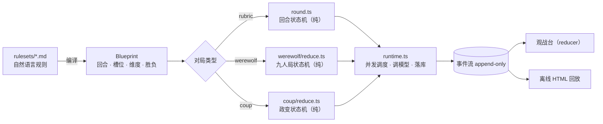

# 斗场 · AI Arena

> 规则由你写，阵容由你挑。多个模型同桌对局：思考只给观众看，胜负交给引擎状态机或盲化裁判，
> 全过程写进 append-only 事件流，可逐帧回放。

[](https://nextjs.org)
[](https://react.dev)
[](https://www.typescriptlang.org)
[](https://bun.sh)
[](https://nodejs.org/api/sqlite.html)
[](#license)



## 这是什么

一个本地跑的「模型对局场」。它不做角色扮演、不注入人格卡：每个模型以自己的身份上场，
看到的是同一份规则和各自的座位信息，然后同时思考、同时出招。

三类对局共用同一套骨架（蓝图 → 纯状态机 → 运行时 → 事件流 → 观战台），但胜负判定的归属完全不同：

| 对局 | 谁决定胜负 | 纯状态机 | 观战台 |
|---|---|---|---|
| **规则对局**（rubric） | 盲化裁判模型按维度打分 | `src/engine/round.ts` | `/arena/[matchId]` |
| **预女猎九人局** | 引擎状态机（屠边） | `src/engine/werewolf/reduce.ts` | `/table/[matchId]` |
| **政变 · 四人桌** | 引擎状态机（影响力） | `src/engine/coup/reduce.ts` | `/coup/[matchId]` |

一句话区分：**规则对局靠裁判理解规则，牌局靠引擎执行规则**。裁判模型只在规则对局里裁决，
在九人局里最多参与「法官发牌」，在政变里根本不出现——「谁掉了一条命」只由 reducer 决定。

## 快速开始

需要 [Bun](https://bun.sh) 1.2+（`bun test` 与 `node:sqlite` 都直接可用）。
用 Node 跑需要 22.5+ 并带 `--experimental-sqlite`。

```bash
git clone https://github.com/keeptrue/ai-arena.git
cd ai-arena
bun install
bun run db:migrate      # 建表 + 灌默认接入方 + 同步 rulesets/
bun run dev             # http://localhost:3099
```

**不需要任何 API Key 也能跑通全流程**：内置「演练场」与十个演练体模型，
九人局 9 席 + 1 裁判也凑得齐。在 `/setups` 填了真实 Key 并拉取模型后，
随机配对会自动优先使用真实模型。

数据库是本地单文件 `data/arena.db`（已 gitignore）；密钥只落 `data/secrets.json`（0600），
不入库、不进 git、不回传前端。

## 三种对局

### 1. 规则对局（rubric）

规则是一段自然语言。在 `/rulesets` 写规则 → 点「编译成蓝图」→ 模型把它转成结构化 JSON
（回合数、每轮提交项、评分维度与权重、胜负方式）→ 你确认或手改 → 开局。

每一轮：所有选手并行发起，思考流实时推给观众，提交内容落库；**全员「就位」或「弃权」后**
才把整轮材料交给裁判。先交不构成优势。裁判只见 A / B / C…（字母每轮重抽），
模型名、厂商名、队伍真名一律不进 judge prompt。

内置四套：`dark-auction`（暗标竞地）、`cricket-duel`（罐中论剑）、
`summit-clash`（山道四十阶）、`interrogation-room`（八轮拷问）。

### 2. 预女猎九人局

`rulesets/werewolf-nine.md`：3 狼、3 民、预言家 / 女巫 / 猎人各 1，无警长。
身份、死亡、票型和胜负由纯状态机判定，**裁判模型不口述任何事实**。

**开桌**

- 9 个座位各选一个模型。座位可以重复使用同一个模型（自我对弈）：重复的座位会亮成琥珀色、
  标出「同模型 ×N」与同桌座位号，下拉里也会写「已在 #3」——但不会拦你开桌。
  两张座位票、自评、弃权都按座位独立计算。
- 身份三种来源：**引擎随机**（默认，按种子洗牌，可复现）、**手动指定**（逐席选身份，
  引擎只校验 3 狼 / 3 民 / 预女猎各 1）、**法官发牌**（调一次裁判模型，引擎校验 3/3/3；
  失败或非法会回退到引擎洗牌，并留一条 anomaly）。
- 裁判是必选的：终局赛后评分需要一张裁判票。桌上某个模型可以兼任裁判（开局页会标「也在桌上」），
  它既打一局、又单独投一张裁判票，两张票分开计入；默认「自动」仍优先挑不在桌上的模型。

**一局怎么走**

1. 夜晚：狼人先低语、给出倾向刀口，再投一次定刀（可改票；多数据票，平票按种子决定；
   可自刀、可空刀）→ 预言家查验一名存活玩家（只知好人 / 狼人）→ 女巫得知刀口后
   用解药、毒药或不用（各 1 瓶，同夜最多 1 瓶，首夜可自救，毒药不能毒自己）。
2. 天亮只公布出局座位，不公布死因。首夜出局者留遗言；之后夜间出局不发言。
3. 猎人被狼刀或被放逐可以开枪；被女巫毒死不能；被枪带走的人不留遗言。
4. 存活者顺时针发言；首日从 1 号位起，之后从昨夜座位号最小的死者下家起，
   平安夜从上一日最后发言者下家起。
5. 全体投票，最高票放逐；平票者 PK 发言后由非 PK 存活者重投，再平票无人出局。
6. 狼人可在自己发言时自爆：翻牌出局、当天立即结束、没有投票，自爆者不留遗言。
7. 屠边胜负：狼人杀光所有神或所有民；好人放逐所有狼人。同一批死亡同时满足两边时
   好人优先。最多 8 天，超时本局无胜者。

**观战台 `/table/[matchId]`**

- 圆桌：9 席按 1–9 顺时针，中心是阶段 / 天数 / 存活 / 阵营计数，右侧是公开编年史与上帝日志。
- **动作即时可见**：狼 / 预 / 巫 / 猎每次提交，夜间正文、席位卡、侧栏行动块同时出现
  「刀 7 号 / 验 2 号 → 好人 / 解药 / 开枪 3 号」；回放到同一帧仍然看得到。
- **四块分开**：行动、发言（含遗言）、旁白（写给观众的 THINK）、原始推理（模型内部）各自成块；
  原始推理默认折叠。
- 默认**上帝视角**（底牌、狼队低语、查验、药剂、死因）；**玩家视角**只保留公开信息，
  终局自动翻牌。玩家视角只是显示层，不是防作弊边界。
- 一局约 20–30 次调用/天，整体 50–90 分钟；慢模型请先在 `/setups` 设模型级时限。
- 打开一局已结束的 `/table/[id]`，页面会从 `/api/matches/[id]` 取全量事件并用 reducer 还原终局。

**导出可回放的 HTML**

对局页右上角「导出 HTML」，或战报表格的「HTML」列，下载一个自包含文件：内联同一套 React 组件、
编译后的 `globals.css` 与压缩事件流；离线打开即可点胶片、切座位、展开旁白 / 原始推理、切日夜主题。
暂停、中止、继续评分等写操作不会带进去。导出选项：带模型推理原文（默认开）、gzip 压缩（默认开）。
运行时资源由 `bun run export:build` 生成（`dev / build / start` 已自动串上），
接口只读 `public/export/`，缺失时会提示先构建。**当前只对九人局提供导出。**

**赛后评分**

终局翻牌后，9 位玩家各评全桌 9 人（包括自己），裁判再盲评一次，合成一份 0–100 的「牌技分」：

- 四维：判断 35% / 表达 30% / 操作 25% / 抗压 10%，每维 1–10。
- 自评只展示，不计入自己的均分；裁判一票按 2 张玩家票计。
- 每个座位至少 4 张同行票时，去掉一张最高、一张最低再平均。
- 不加胜负分，败方也可以拿本局最高分；特别票另计「同行 MVP / 最会说 / 最会骗」。
- 评分是独立事件管线（`review.opened / review.ballot / review.verdict`），不改写对局事实；
  终局后自动跑，进程中断可在页面上「继续评分」，只补缺票。
- 一局额外 10 次调用，默认 3 并发、单票 180 秒、总时限 6 分钟；评委只看公开记录与终局翻牌，
  模型名、接入方、旁白与原始推理都不进评分 prompt。

九人局提示词内置在 `src/engine/werewolf/prompt.ts`（阶段感知、带合法目标清单），
不进入 `/prompts` 编辑器；要改措辞直接改这个文件。

### 3. 政变 · 四人桌

`rulesets/coup-four.md`：四名玩家各持两张暗牌、两枚金币，牌堆十五张
（公爵 / 刺客 / 队长 / 大使 / 伯爵夫人各三张）。**没有裁判，也没有并发打分**——
宣称是否成立、谁掉命、金币怎么走，全部由 `src/engine/coup/reduce.ts` 结算。

- **七种行动**：收入（1 枚）、外援（2 枚）、政变（付 7 枚取一条命）、征税（公爵，3 枚）、
  刺杀（刺客 + 3 枚）、偷窃（队长，2 枚）、换牌（大使，抽 2 换 2）。
- **角色行动都是宣称**，不要求真的持有那张牌；收入与政变不可质疑、不可阻挡。
- **质疑只认第一个开口的人**：亮得出牌 → 质疑者掉命、被质疑者洗回该牌随机补抽、行动继续；
  亮不出 → 行动作废、已付金币全额退回、被质疑者掉命。
- **阻挡**：外援可被任何人用公爵挡；刺杀只有目标能用伯爵夫人挡；偷窃只有目标能用队长或大使挡。
  阻挡本身也可被质疑。阻挡成立时行动失败，**已付金币不退**。
- 回合开始时有 10 枚以上金币则本回合只能政变；最多 60 手，超时按剩余影响力、再按金币判胜，
  仍并列则无胜者。

**观战台 `/coup/[matchId]`**

- 四席围桌，手牌、金币、已失去的牌实时变化；每一手按「宣称 → 弃权 → 表态 → 阻挡 → 结质疑 →
  质疑阻挡 → 结阻挡 → 掉命 → 金币」展开成时间线（`describeTurnSteps`），点任意一手可 pin 到
  右侧「本手」Tab；点座位打开「档案」（明牌、实时自述、历史发言）。
- **AI 解说**（可选，开局时选模型）：读全牌、只给观众看，每手结算后写两三句「谁诈唬了、为什么」。
  它不判定任何事实，**输出绝不进玩家 prompt**。
- 玩家自述（`note`）边写边流到座位卡；落地文案取「实时流」与「引擎截断版」中较长的那份。
- 一局约 120–180 次调用。

## 观战台怎么读（规则对局）

- **离开也不会丢**：顶栏会留一枚「回到对局」芯片（对局名 + 已裁决轮次），点它直接回场；
  人已经在该局页面时自动隐藏。进行中的对局优先于回放。芯片 14 天后过期，也可手动移除。
- 每个座位头部是身份：显示名、厂商、真实模型 id、思考档位（含显式预算）；次行是温度
  （单独设过时限时还会显示 `时限 45m`），右侧是本次调用的 token 与耗时。
- **思考**与**出招**分成两个区块：思考灰底、按原文换行，默认只展示前 500 字、其余折叠成
  「展开全文」；出招绿底、按槽位分字段（数字右对齐、选项成 chip、暗项带 🔒）。
- 历史裁决按「每方一块」：字段化出招 + 可折叠思考（默认收起）；裁判自己的推演也能展开。
- 页头常驻裁判身份。裁判在开局那一刻冻结并写进 `matches.judge_json`，第一轮裁决之前就能看到是谁在裁。

## 硬规则

- **思考只给观众**。对手看不到，裁判也看不到——他读的只有提交内容。模型可以在思考里说真话、
  在提交里撒谎，博弈才成立。
- **思考是一段 500 字说明**：说清「为什么这么选」。超出部分默认折叠、可展开；实时推演照常流、
  不丢尾（直播面只保留最近 4000 字的窗口，全文始终落在 `seat.submitted` 里）。
- **引擎不理解规则语义**。它只保证同时性、完整性和留档；「这一手算不算赢」全交给裁判。
- **裁判看不到身份**。每轮重新映射 A/B/C，模型名、厂商名、队伍真名都不进 prompt。
- **没有角色扮演**。不加人格卡、不加人设前缀，模型说什么就是它自己。
- **事件是唯一真相**。状态变化必须落成事件；`state.snapshot` 只用于崩溃恢复。

## 规则怎么写

打开 `/rulesets`：左边用自然语言写规则，点「编译成蓝图」，模型把它转成结构化 JSON，
你确认或手改后保存即可开局。

- `reveal: "secret"` 的槽位只有裁判看得到（暗标、底牌），`public` 的进下一轮公开战况。
- 权重随便写，保存时会自动归一化。
- 六条内置规则：`dark-auction`（暗标竞地）、`cricket-duel`（罐中论剑）、`summit-clash`（山道四十阶）、
  `interrogation-room`（八轮拷问）、`werewolf-nine`（预女猎九人局）、`coup-four`（政变 · 四人桌）。

### 战况面板（可选）

规则想让人看见血量、山道这类数字，就在蓝图里加 `board`，观战台会自动画出来：

```json
"board": {
  "meters": [
    { "key": "hp", "label": "血量", "kind": "bar", "min": -6, "max": 26, "init": 18, "threshold": 10 },
    { "key": "pos", "label": "山道", "kind": "track", "min": 0, "max": 40, "init": 0 }
  ],
  "marks": { "label": "雷位" }
}
```

- `kind` 三选一：`bar`（带临界线的条）、`count`（数字计数器）、`track`（0–max 赛道，最多一条）。
- 声明了 `board`，裁判每轮就要在 JSON 里多回一个 `state`（**本轮结束后的绝对值**，不是变化量）；
  有 `marks` 的再回一个 `marks`（当前仍在的标记格，比如没爆的雷）。
- 引擎只按声明范围裁剪数字，不理解它们的含义；裁剪 / 丢弃会写成 `anomaly` 事件。
- 裁判漏回读数的轮次：面板停在上一轮并标「读数缺失」，不会崩。

### 引擎账本（确定性玩法用）

血量、偿还次数这类**能算出来**的数字不该让模型口算：字母每轮重抽，历史里上一轮的
「A 15 / B 19」到这一轮就是两个人。规则的结算表写进蓝图，引擎按它记账：

```json
"board": {
  "meters": [
    { "key": "hp", "label": "血量", "kind": "bar", "min": -6, "max": 26, "init": 18, "threshold": 10 },
    { "key": "betray", "label": "出卖", "kind": "count", "min": 0, "max": 8, "init": 0 }
  ],
  "settle": {
    "by": "move",
    "forfeit": "合作",
    "cells": [
      { "a": "合作", "b": "合作", "delta": [{}, {}] },
      { "a": "合作", "b": "出卖", "delta": [{ "hp": -3 }, { "hp": 1, "betray": 1 }] },
      { "a": "出卖", "b": "合作", "delta": [{ "hp": 1, "betray": 1 }, { "hp": -3 }] },
      { "a": "出卖", "b": "出卖", "delta": [{ "hp": -2, "betray": 1 }, { "hp": -2, "betray": 1 }] }
    ]
  }
}
```

- `by` 必须是 `choice` 槽位，`cells` 必须**穷尽**该槽位的所有组合（缺一格直接报错，不会默认记 0）；
  `a` 是序号较小的一方。`forfeit` 是弃权 / 缺席顶替的取值。
- 有 `settle` 时读数由引擎算，裁判的 `state` 只用来对账：不一致会写成 `board_mismatch` 并采纳引擎值。
- 分数也能钉死：维度上写 `derive`，引擎算 `base + per × 本轮该指标变化`，裁判不再写这个维度。
  `bar` = `{ "meter": "hp", "base": 5, "per": 1 }`，八轮累计 = `22 + 终局血量`。
- 账本只支持**两方各 1 人**的对局；阵容不符时开局直接拒绝。
- 老对局（快照里没有 `settle`）可以用 `bun run db:repair <matchId>` 按真实出手重算并追加
  `board.reconciled` 事件：只追加、不删改，页面立刻显示修正后的血线与分数。
- 改了内置规则的蓝图后，`bun run db:rulesets` 才会把新版本写进库（种子逻辑从不覆盖已有行）；
  对局读的是自己的快照，历史不受影响。

## 配置

`/setups` 里三段：

- **接入方** —— 名称、类型（openai / anthropic / gemini / mock）、base URL、Key 全部自填，可增删改。
- **模型池** —— 点「拉取模型」从接入方拉回真实模型清单（OpenAI 兼容 `/models`、
  Anthropic `/v1/models`、Gemini `/v1beta/models`），再逐个勾「选手 / 裁判 / 启用」。
  代码里没有任何写死的模型。
- **裁判** —— 开局页从「裁判池」里指定谁坐裁判席；默认「自动」，优先挑与选手不同接入方的模型。
  指定结果在开局瞬间冻结进 `matches.judge_json`。裁判与选手同接入方时会提示可能带自偏好，但不阻止。
- **思考强度** —— 每个模型单独配。点「校准」从 [models.dev](https://models.dev) 拉取该模型的能力卡
  （是否支持思考、可选强度、上下文与价格），然后在下拉里选档位。见下节。

## 提示词（全局内置）

`/prompts` 里改选手、裁判、规则编译器收到的 system 提示词，存库后对之后所有对局生效：

- **选手 system** —— 定位、规则、座位与输出协议。必须保留 `<<<THINK>>>`、`<<<SUBMIT>>>`，
  以及 `{{scene}}`、`{{briefing}}`、`{{team}}`、`{{mates}}`、`{{submitShape}}`。
- **裁判 system** —— 盲化视角下的判分说明。`{{format}}` 决定普通轮与加时轮各自的输出 JSON 骨架。
- **规则编译 system** —— 自然语言 → 蓝图的编译约束，`{{maxRounds}}` 等上限由引擎填。
- **全局附加指令** —— 非空时追加到选手与裁判 system 的末尾，留空即关闭。

保存时会拒绝缺占位符或缺协议标记的模板；「恢复默认」删掉存档，回到内置版本。
模板只负责措辞：动态事实（队名、座位、历史提交）仍由引擎注入，所以盲化与迷雾不依赖提示词。
正在跑的对局从下一轮调用起读到新模板，历史对局不受影响。

## 思考强度

同一个模型，档位不同，打法就是两个模型。所以强度是**模型级配置**，随对局快照冻结：

- **档位**（`none / minimal / low / medium / high / xhigh / max`）来自 models.dev 的
  `reasoning_options`；不同模型支持的档位不同，UI 只列它真正接受的。
- **落线方式**由 provider 决定，全部在 `src/providers/reasoning.ts` 里：
  OpenAI 兼容 → `reasoning_effort`（OpenRouter 走 `reasoning.effort`）；
  Anthropic → `thinking.budget_tokens`（档位换算预算，压到 `[1024, max_tokens/2]`——
  思考与正文共享 `max_tokens`，不给正文留余量就会得到一段空白回答）；
  Gemini 3.x → `thinkingLevel`，Gemini 2.5 → `thinkingBudget`。
- **优先级**：显式「预算」> 档位换算 > provider 默认（不传）。
- **不支持思考的模型**不会收到任何思考参数；models.dev 说该模型不吃 `temperature` 时，
  也不再发 `temperature`（GPT-5 这类会直接 400）。

数据源是公开的 `https://models.dev/api.json`（不需要 Key，进程内缓存 6 小时）。
要换镜像或离线包，设 `MODELS_DEV_URL`。校准只写本地 `models` 表——历史对局读的是
`participants.model_json` 快照。

## 慢模型与坏输出

一场对局必须等全员交齐，所以每一次调用都有界——但**思考久本身不是故障**：
只要模型还在吐字，它就是在推进，计时器会跟着它一直续。只有「没进展」和「超上限」才截断。

- **静默检测**：`ARENA_STALL_MS`（默认 180s）内没有任何新内容 → 判定卡死并中止本次调用
  （`stream_stalled`）。SSE 的 `:` 心跳、只带 `role` 的空 delta、只带 usage 的帧都算连接活着
  （provider 的 `onBeat`），所以一个还在 ping 的网关不会被误判成断流。
- **静默重试**：剪断时如果这一趟**一个字都没收到**，会自动重开一次（`ARENA_STALL_RETRY`，默认 1，
  `0` 关闭），事件流里留一条 `stall_retried`。已经吐过内容再断的不重试——那是把同一段思考计费两遍。
- **模型级时限**：单次调用总时限默认 30 分钟（`ARENA_CALL_TIMEOUT_MS`，`0` = 不限，只是计费兜底）。
  慢模型可以在 `/setups` 单独设 1–120 分钟，随对局快照冻结，只影响它自己（`call_timeout`）。
- **补叫（recall）**：判成弃权之后，只要本阶段还没收尾，可以在弃权徽章旁点「补叫 / 重叫」把这个座位
  重新叫一次：弃权计数回滚、AFK 解除、九人局里它迟到的那一票仍然算数。阶段一旦推进就会拒绝
  并说明原因——补叫不能改写已经发生的事实。
- **重复片段检测**：同样的 60 字窗口重复 6 次以上，判定在原地打转，立刻截断（`thinking_loop`）。
- **内存兜底**：`ARENA_MAX_THINKING_CHARS`（默认 2000000 字符）只防真死循环，`0` 关闭。
- **直播节奏**：思考流每 `ARENA_FLUSH_MS`（默认 80ms）推一次，单包不超过 `ARENA_FLUSH_MAX_CHARS`
  （4096 字符）；超过 `ARENA_FLUSH_BUDGET`（600）条后再按倍数放慢间隔，上限 1 秒。
  节奏按时间而不是按字数定，所以三万字和三百字的流一样顺。
- **裁判 JSON**：走 provider 原生 JSON 模式；解析失败会带着原答案重试一次严格 JSON。

## 一局的时序（规则对局）

1. 选规则、编队（1v1 / 1v2 / 1v3 / 2v2 / 混战）、定裁判（默认自动）、掷种子。
2. 每一轮：**所有选手并行**发起，思考流实时推给观众，提交内容落库。
3. 全员「就位」或「弃权」后，才把整轮材料交给裁判——先交不构成优势。
4. 裁判盲化打分（只看到 A / B / C…），给出本轮判词与公开战况。
5. 累计分；打满则按分差决定是否进入一轮加时（突然死亡）。

## 命令

```bash
bun run dev          # 开发（:3099，含 export:build）
bun run build        # 生产构建
bun run start        # 生产启动（:3099）
bun run export:build # 单独重建离线导出运行时（public/export）
bun test             # 引擎 / 协议 / 盲化 / 账本 / 思考参数 / 牌局 测试（562 项，41 个文件）
bun run typecheck    # tsc --noEmit
bun run db:migrate   # 建表 + 同步内置规则
bun run db:seed      # 只灌默认接入方与演练体
bun run db:rulesets  # 用 rulesets/*.blueprint.json 覆盖已有内置规则
bun run db:repair <matchId>  # 按账本重算老对局的读数（追加事件，不删改）
```

旧版（数值战斗）的数据库不兼容：`db:migrate` 会检测到 `games` 表并重建，对局数据会清空。
这是开发期的破坏式迁移，正式使用前请先备份 `data/arena.db`。

## 目录

```
src/engine/          蓝图校验、回合状态机、协议解析、提示词模板、账本、缓存闸门、运行时
src/engine/werewolf/ 九人局：发牌、纯状态机、提示词、赛后评分（独立运行时）
src/engine/coup/     政变：发牌、纯状态机、提示词、解说、时间线、赛后评分
src/providers/       openai-compat / anthropic / gemini / mock（裸 fetch）+ 拉取模型 + models.dev
src/db/              node:sqlite + DDL + repo（所有 SQL 都在 repo.ts）
src/lib/             视图模型（九人局 / 政变 / 战况面板）、事件总线、密钥、规则同步
src/app/             开局 / 规则 / 对局 / 提示词 / 配置 / 三种观战台 / SSE API
src/export/          离线 HTML 回放的入口
rulesets/            自然语言规则 + 预编译蓝图
tests/               562 项，纯函数夹具，不联网、不开端口、不碰 data/
docs/                设计稿
```

## 开发规范

改代码前先读 [`AGENTS.md`](AGENTS.md)：六条硬约束、依赖方向表、迁移政策、看门狗阈值，
以及一张「踩过的坑」表。提交前的三步检查也在那里：

```bash
bun test
bun run typecheck
bun run build
```

## 已知边界

- **单进程**：运行中的对局状态挂在 `globalThis`（`__arenaRuntime` / `__arenaWerewolf` /
  `__arenaCoup` / `__arenaBus`），多实例部署无法共享，也还没有跨进程锁。
- **没有账号体系**：默认当作本机工具用，别直接暴露到公网。
- **SQLite 单文件**：写入靠单进程串行，适合个人 / 小团队，不适合高并发多桌。
- **离线导出只覆盖九人局**；规则对局与政变目前只在网页里回放。
- **引擎账本只支持两方各 1 人**的对局。
- 迁移是纯增量的 `ALTER`，但遇到远古 `games` 表会整库重建。

## License

[MIT](LICENSE) © 2026 Inkedus
